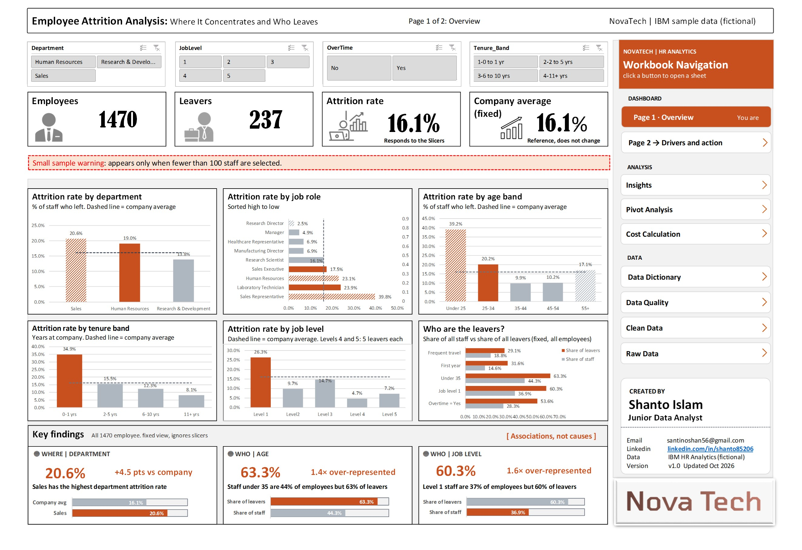
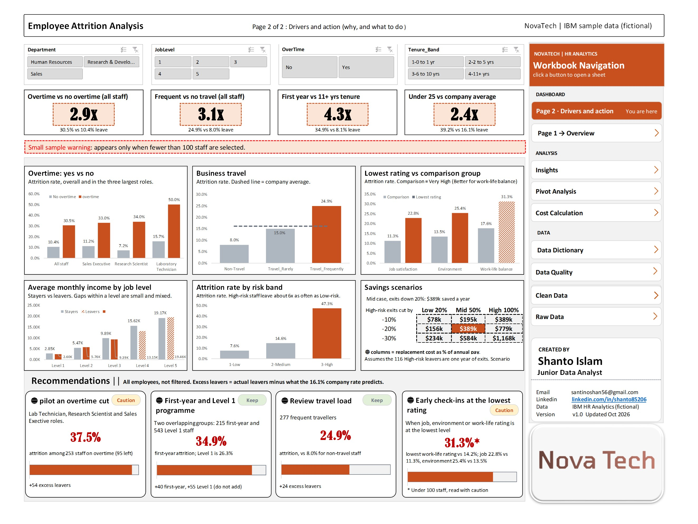

# Employee Attrition Analysis

**An interactive 2-page Excel dashboard that shows where employee attrition concentrates, who leaves, and which retention actions are worth testing first.**


-lightgrey)


---

## Dashboard Preview


*Page 1: Overview. How big the problem is, where it sits and who leaves.*


*Page 2: Drivers and action. Why people leave and what to do about it.*

---

## Table of Contents

- [Business Problem](#business-problem)
- [Executive Summary](#executive-summary)
- [Data Source](#data-source)
- [Data Cleaning](#data-cleaning)
- [Methodology](#methodology)
- [Key Findings](#key-findings)
- [Recommendations](#recommendations)
- [Limitations and Next Steps](#limitations-and-next-steps)
- [Repository Structure](#repository-structure)
- [About the Author](#about-the-author)

---

## Business Problem

NovaTech (a fictional company) lost 237 of its 1,470 employees, an attrition rate of 16.1%. HR needs to know where the losses concentrate, which factors are linked to leaving, and which actions to test first.

This project answers seven questions: which department, which job roles, whether overtime, age and tenure, satisfaction ratings, business travel, and marital status are linked to attrition, and whether there is a gender gap.

## Executive Summary

| Metric | Value |
|---|---|
| Employees | 1,470 |
| Leavers | 237 |
| Attrition rate | 16.1% |
| Highest-attrition department | Sales, 20.6% |
| Highest-attrition job role | Sales Representative, 39.8% (33 of 83) |
| Overtime vs no overtime | 30.5% vs 10.4% (about 2.9x) |
| First-year staff vs 11+ years | 34.9% vs 8.1% (about 4.3x) |
| Mid-case saving scenario | \$389k a year |

Attrition is concentrated in specific groups rather than spread evenly. Sales Representatives, overtime workers, first-year staff and staff under 25 all leave at well above the 16.1% company rate. These are associations in the data, not proven causes.

## Data Source

| Item | Detail |
|---|---|
| Dataset | [IBM HR Analytics Employee Attrition & Performance (Kaggle)](https://www.kaggle.com/datasets/pavansubhasht/ibm-hr-analytics-attrition-dataset) |
| Original file | WA_Fn-UseC_-HR-Employee-Attrition |
| Nature of data | Fictional sample data created by IBM data scientists. "NovaTech" is a fictional company name used as a label on the dashboard. |
| Size | 1,470 employees, 35 columns |
| Target field | Attrition (Yes = 237, No = 1,233) |
| Time period | None. The data is a single snapshot with no dates. |
| Currency | Not stated in the dataset. The dashboard uses \$. |

## Data Cleaning

| Step | What was done |
|---|---|
| 1. Column review | Each of the 35 columns was marked Keep, Drop or Check in the `Data_Dictionary` sheet. 29 columns kept, 6 dropped. |
| 2. Single-value columns dropped | `EmployeeCount` (always 1), `StandardHours` (always 80), `Over18` (always Y). |
| 3. Unclear pay-rate columns dropped | `DailyRate`, `HourlyRate`, `MonthlyRate`. Meaning is unclear and correlation with `MonthlyIncome` is near zero (0.01, -0.02, 0.03). |
| 4. Quality checks | 1,470 rows, 0 blank cells, 0 duplicate employee IDs. |
| 5. Seniority check | `MonthlyIncome` and `JobLevel` have a correlation of 0.95, so `JobLevel` is used as the seniority measure. |
| 6. Readable labels | 1 to 4 rating codes converted to text labels in 7 new columns, for example `1-Low` to `4-Very High`. |
| 7. Flags and bands | Added `Attrition_Flag` (1 = left), `Age_Band`, `Tenure_Band`, `Income_Band`, `Risk_Score` and `Risk_Band`. |
| 8. Validation | 0 label errors, 0 blanks in labels, flag and bands, and the flag total matches the 237 leavers. |

The cleaned sheet has 29 original columns and 13 added columns.

## Methodology

**Tool:** Microsoft Excel (PivotTables, slicers, formulas, charts and KPI cards).


**How the dashboard works**

- Four slicers (Department, JobLevel, OverTime, Tenure_Band) filter the KPI cards and charts.
- The company average (16.1%), the Key findings panel and the Draft recommendations panel use all 1,470 employees and ignore the slicers.
- A small-sample warning appears when fewer than 100 staff are selected.
- A navigation panel on each page opens the other sheets: Insights, Pivot Analysis, Cost Calculation, Data Dictionary, Data Quality, Clean Data and Raw Data.

## Key Findings

| Area | Finding |
|---|---|
| Department | Sales has the highest attrition at 20.6%, which is 4.5 points above the company average. R&D has the most leavers (133) but the lowest rate (13.8%). HR is at 19.0% but has only 63 staff, so treat it with caution. |
| Job role | Sales Representative (39.8%, 33 of 83) and Laboratory Technician (23.9%, 62 of 259) are highest. Together they hold 23% of staff but 40% of leavers. Research Director is lowest at 2.5% (2 of 80). |
| Overtime | Overtime workers leave at 30.5% (127 of 416) vs 10.4% (110 of 1,054). They are 28% of staff but 54% of leavers. |
| Overtime within roles | The gap holds in the three largest roles: Laboratory Technician 50.0% vs 15.7%, Research Scientist 34.0% vs 7.2%, Sales Executive 33.0% vs 11.2%. |
| Tenure | First-year staff leave at 34.9% (75 of 215) vs 8.1% for staff with 11+ years. |
| Age | Staff under 25 leave at 39.2% (38 of 97). Staff under 35 are 44% of employees but 63% of leavers. |
| Job level | Level 1 staff are 37% of employees but 60% of leavers (26.3% attrition). |
| Business travel | Frequent travellers leave at 24.9% (69 of 277) vs 8.0% (12 of 150) for non-travellers. |
| Satisfaction ratings | Lowest job satisfaction 22.8% (66 of 289) vs 11.3% (52 of 459) at the top rating. Lowest environment satisfaction 25.4% (72 of 284) vs 13.5% (60 of 446). Bad work-life balance 31.3% (25 of 80) vs 14.2% (127 of 893), a small group. |
| Marital status | Single staff leave at 25.5% (120 of 470) vs 12.5% for married and 10.1% for divorced. Single staff are 32% of employees but 51% of leavers. This overlaps with age. |
| Pay | Within each job level, average monthly income of stayers and leavers is close and the gaps are mixed. |
| Risk band | Attrition is 47.3% in the High band, 14.6% in Medium and 7.6% in Low, so High-risk staff leave about 6x as often as Low-risk staff. |
| Gender | Women leave at 14.8% (87 of 588) and men at 17.0% (150 of 882). The gap is small and could arise by chance, so no gender difference is reported. |

## Recommendations

| # | Recommendation | Evidence | Excess leavers* | Dashboard tag |
|---|---|---|---|---|
| 1 | Pilot an overtime cut in Laboratory Technician, Research Scientist and Sales Executive roles | 37.5% attrition among 253 staff on overtime (95 left) | +54 | Caution |
| 2 | First-year and Level 1 programme (onboarding and early-career support) | 34.9% first-year attrition (215 staff); Level 1 is 26.3% (543 staff) | +40 first-year, +55 Level 1 (overlapping groups, do not add) | Keep |
| 3 | Review travel load for frequent travellers | 24.9% attrition among 277 frequent travellers vs 8.0% for non-travel staff | +24 | Keep |
| 4 | Early check-ins for staff at the lowest rating | Lowest work-life rating 31.3% vs 14.2% (under 100 staff); job satisfaction 22.8% vs 11.3%; environment 25.4% vs 13.5% | n/a | Caution |

*Excess leavers = actual leavers minus what the 16.1% company rate would predict.

**Not recommended:** gender-targeted action. The gap is small and the data does not support it.

**Savings scenarios**

Replacement cost per exit, as a share of annual pay (\$33,573 per exit), applied to the 116 High-risk leavers, assumed to be one year of exits.

| High-risk exits cut by | Low (20%) | Mid (50%) | High (100%) |
|---|---|---|---|
| 10% | \$78k | \$195k | \$389k |
| 20% | \$156k | \$389k | \$779k |
| 30% | \$234k | \$584k | \$1,168k |

The mid case (exits down 20%, replacement cost 50% of annual pay) gives \$389k saved a year. These are scenario estimates, not forecasts.

## Limitations and Next Steps

**Limitations**

- The data is fictional sample data and a single snapshot. There are no dates, so attrition cannot be tracked over time.
- Findings are associations, not causes. Overtime, age, tenure and job level overlap, so their effects should not be added together.
- Several groups are small: HR department (63 staff), bad work-life balance (80 staff), Level 4 and Level 5 (5 leavers each), Research Director (2 of 80). These should not be ranked with confidence.
- Risk bands are built from fields in the same dataset they are tested on, so the 6x gap is descriptive, not a validated prediction.
- The cost scenarios assume the 116 High-risk leavers are one year of exits and use an assumed replacement-cost share, not actual replacement costs.
- The dataset does not state a currency.
- The data should not be used to make decisions about individual employees.

**Next steps**

- Check whether the overtime gap still holds when pay, manager and workload are controlled for.
- Test the risk band on data it was not built from.
- Replace the assumed replacement-cost share with actual hiring and training costs.

## Repository Structure

```text
HR-Employee-Attrition-Analysis-Excel/
├── README.md
├── HR_Employee_Attrition_Clean_Data_Dashboard_20261028_V01.xlsx
├── HR_Employee_Attrition_Raw_Data_20261028_V01.xlsx
├── HR_Employee_Attrition_Dashboard_Page1_20261028_V01.jpg
└── HR_Employee_Attrition_Dashboard_Page2_20261028_V01.jpg
```

- **Clean_Data_Dashboard workbook:** both dashboard pages plus the Insights, Pivot Analysis, Cost Calculation, Data Dictionary, Data Quality, Clean Data and Raw Data sheets.
- **Raw_Data file:** the original IBM dataset, unchanged.
- **Dashboard images:** preview images of the two dashboard pages.

## About the Author

**Shanto Islam**, Junior Data Analyst. I build Excel dashboards, clean data and turn analysis into clear recommendations.

- GitHub: [shanto-islam-analytics](https://github.com/shanto-islam-analytics)
- LinkedIn: [linkedin.com/in/shanto85206](https://www.linkedin.com/in/shanto85206)
-
